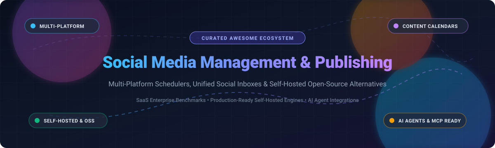

# 🚀 Awesome Social Media Management & Publishing

**A curated index of top-tier SaaS platforms and self-hosted open-source software for social media scheduling, cross-platform publishing, multi-brand content calendars, and social listening.**

---

## 📌 Table of Contents

- [🌐 Sector Overview & Market Dynamics](#-sector-overview--market-dynamics)
- [🏢 SaaS & Hosted Commercial Platforms](#-saas--hosted-commercial-platforms)
- [💻 Open-Source GitHub Projects](#-open-source-github-projects)
  - [⭐ Featured Open-Source Schedulers](#-featured-open-source-schedulers)
  - [🛠️ Specialized & Emerging Open-Source Tools](#️-specialized--emerging-open-source-tools)
- [⚖️ SaaS vs. Self-Hosted: Architecture & Caveats](#️-saas-vs-self-hosted-architecture--caveats)
- [🤝 How to Contribute](#-how-to-contribute)
- [📄 Disclaimer](#-disclaimer)

---

## 🌐 Sector Overview & Market Dynamics

The global social media management market is estimated at **$24.5 billion to $28.3 billion in 2025–2026** and is projected to expand at a Compound Annual Growth Rate (CAGR) of over **21%** toward the end of the decade. 

The sector displays a **moderately fragmented** competitive structure: public enterprise giants (such as HubSpot and Sprout Social) and private bellwethers (Hootsuite, Brandwatch) dominate high-ACV corporate contracts and enterprise listening, while a massive long-tail of SMB tools (Buffer, Later, Loomly) and self-hosted open-source engines (Postiz, Mixpost, Brightbean) compete vigorously for creators, agile marketing agencies, and privacy-conscious engineering teams.

---

## 🏢 SaaS & Hosted Commercial Platforms

The table below catalogs leading commercial solutions, sorted in descending order by company scale (enterprise market capitalization or private equity valuation):

| Platform | Company Scale (Valuation / Market Cap) | Key Capabilities | Starting Paid Tier Pricing | Free Tier / Free Trial Limits |
| :--- | :--- | :--- | :--- | :--- |
| **[HubSpot Social](https://www.hubspot.com/products/marketing/social-media)** | ~$28B+ Market Cap *(NYSE: HUBS)* | Integrated social publishing, lead attribution, social listening connected directly to CRM | **$800/mo** *(Marketing Hub Professional, billed annually)* | **14-Day Free Trial** (Full access to Professional features; no free tier for social module) |
| **[Sprout Social](https://sproutsocial.com/)** | ~$1.6B–$2.0B Market Cap *(NASDAQ: SPT)* | Enterprise-grade scheduling, Smart Inbox, sentiment monitoring, team workflow approval chains | **$199/seat/mo** *(Standard plan, billed annually)* | **30-Day Free Trial** (All primary features unlocked, no credit card required) |
| **[Hootsuite](https://www.hootsuite.com/)** | ~$1.0B Valuation *(Private / PE-backed)* | Omnichannel scheduling, cross-network calendar, OwlyWriter AI, listening streams, analytics | **$99/mo** *(Standard plan, 1 user, 10 social accounts, billed annually)* | **30-Day Free Trial** (Access to Professional plan limits, credit card required) |
| **[Brandwatch](https://www.brandwatch.com/)** | ~$450M Valuation *(Acquired by Cision)* | Deep AI social listening, consumer intelligence, influencer discovery, brand protection | **~$800–$1,000/mo** *(Enterprise customized package contract)* | **Demo on Request / 14-Day Guided Sandbox Trial** (Enterprise evaluation only) |
| **[Agorapulse](https://www.agorapulse.com/)** | ~$120M–$150M Est. Valuation | Social inbox, automated publishing, competitor benchmarks, ROI analytics reporting | **$49/user/mo** *(Standard plan, billed annually)* | **30-Day Free Trial** (Free forever plan deprecated; trial grants 10 profiles & 1 user) |
| **[Buffer](https://buffer.com/)** | ~$100M+ Est. Valuation | Clean scheduling, customizable queuing, visual grid preview, lightweight analytics | **$6/channel/mo** *(Essentials plan, billed monthly or $5/ch/mo annually)* | **Free Forever Plan** (Up to 3 social channels, 10 scheduled posts per channel) |
| **[Later](https://later.com/)** | ~$80M–$100M Est. Valuation *(Acquired by Mavrck)* | Visual social scheduler, Instagram grid planner, Link in Bio tool, creator content management | **$16.67/mo** *(Starter plan, billed annually at $200/yr)* | **14-Day Free Trial** (Access to Starter tier; legacy free plan reduced to trial only) |
| **[Loomly](https://www.loomly.com/)** | ~$40M–$60M Est. Valuation | Brand success platform, post mockups, collaborative editorial approvals, custom workflows | **$32/mo** *(Base plan, 2 users, 10 social accounts, billed annually)* | **15-Day Free Trial** (Full access to all features, no credit card required) |
| **[SocialPilot](https://www.socialpilot.co/)** | ~$35M–$50M Est. Valuation | Agency multi-client management, bulk scheduling, white-label client dashboards | **$25.50/mo** *(Professional plan, 7 accounts, 1 user, billed annually)* | **14-Day Free Trial** (Full access to selected plan; no permanent free tier) |
| **[Sendible](https://www.sendible.com/)** | ~$30M–$45M Est. Valuation *(Acquired by Traject)* | Agency-centric social posting, custom client reporting, RSS auto-publishing | **$25/mo** *(Creator plan, 1 user, 6 social profiles, billed annually)* | **14-Day Free Trial** (Includes access to scheduling, reporting, and inbox) |

---

## 💻 Open-Source GitHub Projects

Self-hosted social media management suites give organizations complete ownership over their content data, direct API access without per-channel subscription surcharges, and integration capabilities with local AI agents (MCP).

The repositories below are ranked by GitHub Star count (descending):

| Repository | GitHub Stars | Core Architecture / Tech Stack | Target Use Case & Strengths |
| :--- | :--- | :--- | :--- |
| **[gitroomhq/postiz-app](https://github.com/gitroomhq/postiz-app)** |  | TypeScript, Next.js, NestJS, Prisma, PostgreSQL, Redis | **Production-Grade Hootsuite / Buffer OSS Alternative**: Supports 30+ networks (X, LinkedIn, Meta, TikTok, YouTube, Threads, Bluesky, Mastodon), visual scheduler, built-in AI post generator, team workspaces, REST API, and native MCP server for Claude and Cursor agent integration. |
| **[inovector/mixpost](https://github.com/inovector/mixpost)** |  | PHP 8.2+, Laravel, Vue.js, Inertia.js, Tailwind CSS | **Self-Hosted Social Engine with Free Lite Tier**: Open-source core supports Facebook Pages, X, and Mastodon. Clean calendar interface, rich media library, multi-account posting, and optional one-time Pro upgrade for 10+ additional social channels. |
| **[leaperone/MultiPost-Extension](https://github.com/leaperone/MultiPost-Extension)** |  | TypeScript, WebExtensions API, React | **Browser-Based One-Click Cross-Poster**: Cross-publishes content across multiple platforms simultaneously directly inside the browser using your existing logged-in sessions, bypassing external server API fees. |
| **[brightbeanxyz/brightbean-studio](https://github.com/brightbeanxyz/brightbean-studio)** |  | Node.js, Next.js, PostgreSQL, Docker | **Full-Stack Agency & Team Scheduler**: Free alternative to Buffer and Sendible. Direct multi-platform publishing (Instagram, Facebook, LinkedIn, TikTok, Threads), client calendar workspaces, and Docker-compose setup. |
| **[SamurAIGPT/postiz-cheap](https://github.com/SamurAIGPT/postiz-cheap)** |  | TypeScript, Node.js, Docker, Next.js | **Lightweight Low-Cost Postiz Fork**: Stripped-down, memory-optimized configuration designed to run on ultra-low-cost VPS instances (~$2–$5/mo) across 8 major networks with AI post generation. |
| **[trypostit/trypost](https://github.com/trypostit/trypost)** |  | PHP 8.4, Laravel, PostgreSQL, Redis, Docker | **Single-Container Agent-Ready Scheduler**: Self-hostable all-in-one container with queue workers and WebSocket server included. Features scheduling to 10 platforms, AI carousel designer, brand tone profiles, and built-in MCP agent server. |
| **[TechSquidTV/Shoutify](https://github.com/TechSquidTV/Shoutify)** |  | Python, FastAPI, React, Docker | **Completely Free Self-Hosted Management Hub**: Minimalist, privacy-respecting dashboard for scheduling, tracking, and distributing social broadcasts across independent developer workflows. |
| **[cogsend/cogsend](https://github.com/cogsend/cogsend)** |  | TypeScript, Cloudflare Workers, D1, Hono | **Serverless Social Scheduler**: "Write once, publish everywhere" engine designed to deploy entirely on your personal Cloudflare account with zero monthly server maintenance costs. |
| **[terrytangyuan/social-media-kit](https://github.com/terrytangyuan/social-media-kit)** |  | TypeScript, React, Vite, Tailwind CSS | **Cross-Platform Content Formatting & Dispatch Toolkit**: Tailored drafting tool for LinkedIn, X, Bluesky, and Mastodon with platform-specific character counters, typography styling, and OAuth token management. |
| **[ndesv21/socialclaw](https://github.com/ndesv21/socialclaw)** |  | Python, Typer, OpenClaw | **CLI & Autonomous Agent Skill**: CLI-based cross-poster designed for automated CI/CD pipelines and autonomous agent execution across 11 platforms including Reddit, Discord, Telegram, and WordPress. |
| **[postmill-ai/postmill-app](https://github.com/postmill-ai/postmill-app)** |  | Next.js, NestJS, Inngest, PostgreSQL | **AI-Native Enterprise Social Suite**: Connects 45+ social channels, Bring-Your-Own-Key (BYOK) AI governance, multi-brand approval trees, unified comment inbox, and campaign management. |
| **[Anil-matcha/Free-AI-Social-Media-Scheduler](https://github.com/Anil-matcha/Free-AI-Social-Media-Scheduler)** |  | Next.js 16, PostgreSQL, Prisma | **Creator-Centric AI Publishing Assistant**: Automated copy proposal generator, video reel scheduling for TikTok, Instagram, and YouTube, alongside traditional feeds. |

---

### ⭐ Featured Open-Source Schedulers

- 🌟 **[Postiz (`gitroomhq/postiz-app`)](https://github.com/gitroomhq/postiz-app)**: The flagship standard in open-source scheduling. It provides feature parity with commercial tools, support for dozens of networks, native Model Context Protocol (MCP) servers, team workflows, and active ongoing development.
- ⚡ **[Mixpost (`inovector/mixpost`)](https://github.com/inovector/mixpost)**: Excellent for PHP and Laravel shops. The Lite edition is 100% open-source for X, Facebook Pages, and Mastodon, with a clean visual calendar.
- 🐳 **[TryPost (`trypostit/trypost`)](https://github.com/trypostit/trypost)**: High-velocity single Docker container setup built for modern AI agent publishing and carousel creation.

---

### 🛠️ Specialized & Emerging Open-Source Tools

- 🧩 **Social Engine**: WordPress plugin integrating social publishing directly into the WordPress CMS editing screen.
- 💻 **gos**: Go-based, minimalist headless command-line scheduler parsing markdown text files with tagging and scheduling metadata.
- 🤖 **SocialClaw**: Headless agentic social skill for running programmatic publishing loops through CLI terminal pipes and automation scripts.

---

## ⚖️ SaaS vs. Self-Hosted: Architecture & Caveats

Before migrating from a commercial SaaS provider (such as Buffer or Hootsuite) to a self-hosted open-source engine, evaluate the following tradeoffs:

| Evaluation Dimension | Commercial SaaS (Sprout, Buffer, Later) | Self-Hosted Open Source (Postiz, Mixpost, TryPost) |
| :--- | :--- | :--- |
| **Developer App Registration** | Handled transparently by the provider via pre-approved partner developer apps. | **You must register your own OAuth apps** on Meta Developer, LinkedIn Developer, X Developer, TikTok Developer, etc. |
| **Cost Predictability** | Recurring monthly seat and per-channel charges ($6–$200+/month). | **Free software license**; you pay only for VPS hosting ($5–$20/month) and any chosen LLM API tokens. |
| **Data Privacy & Compliance** | Data and client post archives stored on multi-tenant commercial cloud servers. | **100% data sovereignty**; posts, analytics, media assets, and tokens reside in your own PostgreSQL / Redis database. |
| **Agentic / MCP Extensibility** | Limited to vendor REST APIs or expensive enterprise integration add-ons. | **First-class Model Context Protocol (MCP)** support enabling local coding agents (Cursor, Claude Desktop) to draft and publish. |

---

## 🤝 How to Contribute

Contributions are welcome! Help expand and maintain this community guide:

1. 🍴 Fork this repository.
2. 🌿 Create a feature branch: `git checkout -b feature/add-new-tool`.
3. 📝 Add your tool to the appropriate table or section following the established column structure.
4. 📬 Submit a Pull Request with a clear description and links.

---

## 📄 Disclaimer

- This curated list is maintained for informational and educational purposes.
- Platform trademarks and brand names belong to their respective corporate entities.
- When self-hosting, ensure compliance with each social network's Terms of Service, developer policies, and published API rate limits.
